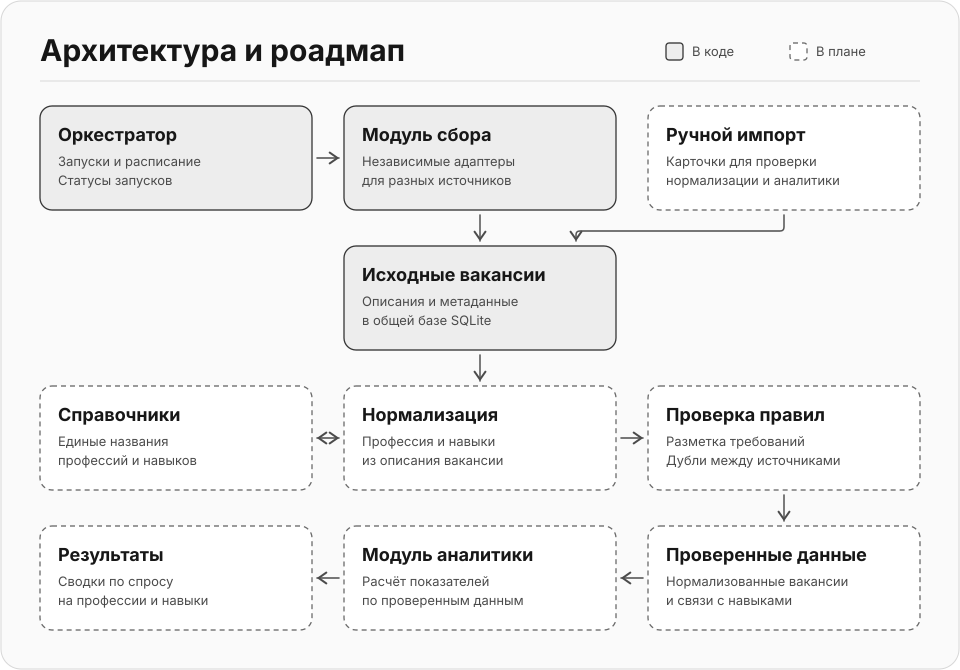
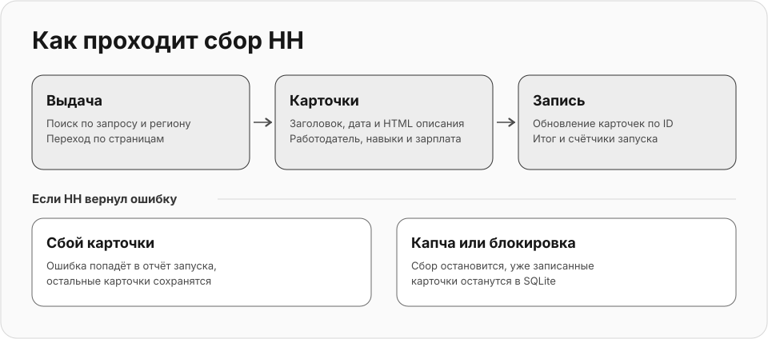

# Анализ рынка вакансий

Собираем вакансии с HH, чтобы сравнивать спрос на профессии и навыки. Это прототип для команды из трёх человек. Сейчас можно запустить сбор, получить полные описания в SQLite и посмотреть результат каждого запуска.

## Архитектура



Проект устроен как модульный монолит на Python. Оркестратор запускает сборщики источников. Исходные вакансии попадают в общую базу, откуда их сможет читать нормализатор. Ручная загрузка в целевой схеме использует тот же вход, чтобы можно было проверить нормализацию на нескольких заранее известных вакансиях.

Нормализатор должен определять профессию и различать обязательные навыки, желательные навыки и навыки, которые применяют в работе. Проверка правил разбирает неоднозначности, например «PostgreSQL или MySQL», и убирает смысловые дубли между источниками. Аналитика работает с проверенными вакансиями и связями с навыками. Эти этапы и ручная загрузка пока описаны в [исходной архитектуре](docs/architecture_vacancy_analysis.md). В коде есть оркестратор сбора, адаптер HH и хранилище.

## Запуск

Нужен Python 3.11 или новее. Команды выполняются из корня репозитория. Зависимостей для установки нет.

Для регулярного сбора укажите токен приложения HH и контакт в `User-Agent`. Токен передаётся через `HH_TOKEN`. Без него API может запросить капчу. Параметр `--area 1` ограничивает поиск Москвой. [Документация API HH](https://api.hh.ru/openapi/redoc)

```sh
read -rs HH_TOKEN
export HH_TOKEN
export HH_USER_AGENT='VacancyAnalysisPOC/0.1 (your-contact@example.com)'

python -m vacancy_analysis run --text 'DevOps' --area 1
python -m vacancy_analysis runs
```

Для одного запроса по заданному периоду используйте `--from` и `--to` с часовым поясом. Границы округляются наружу до пяти минут. Такой запуск не меняет позицию регулярного сбора.

```sh
python -m vacancy_analysis run --text 'DevOps' --area 1 \
  --from '2026-11-23T12:00:00+03:00' --to '2026-11-23T13:00:00+03:00'
```

`watch` запускает сбор сразу и после завершения ждёт заданное число секунд. При первом автоматическом запуске берутся последние сутки. Дальше для каждой пары «поисковый запрос и регион» отсчёт идёт от последнего успешного запуска с перекрытием в пять минут. Для другой базы передайте `--db путь` перед подкомандой. По умолчанию база лежит в `data/vacancies.sqlite3`.

```sh
python -m vacancy_analysis watch --text 'DevOps' --area 1 --interval 3600
```

## Как собираем HH



Поиск возвращает ID, а второй запрос по каждому ID загружает полное описание. Разметку описания сохраняем как есть. Навыки, которые указаны в карточке HH, лежат в метаданных вместе с регионом, работодателем, опытом и зарплатой.

Если поиск находит больше 2 000 вакансий, сборщик делит период на окна. Если даже пятиминутное окно переполнено, запуск получает ошибку с границами окна. Для такого окна нужно сузить запрос. При повторном получении ID обновляется существующая карточка. Успешно загруженные карточки сохраняются и при частичном сбое.

| Таблица | Что хранит |
| --- | --- |
| `raw_vacancies` | Последняя полученная карточка под ключом `(source, external_id)` |
| `runs` | Фильтры, окно дат, статус и сводка запуска |
| `run_vacancies` | Связь запусков с сохранёнными карточками |

Разовый запуск возвращает код `0` при успехе, `2` при частичном результате и `1` при ошибке. Сбор идёт по времени публикации. Отдельного пересмотра старых карточек для отслеживания правок и архивации в прототипе пока нет. Если HH вернул карточку с признаком архива, ранее сохранённая копия удаляется.

## Проверка

```sh
python -m unittest discover -s tests -v
```

Тесты подставляют ответы API и проверяют работу с реальной временной SQLite. Для проверки с HH используется обычная команда `run`.
