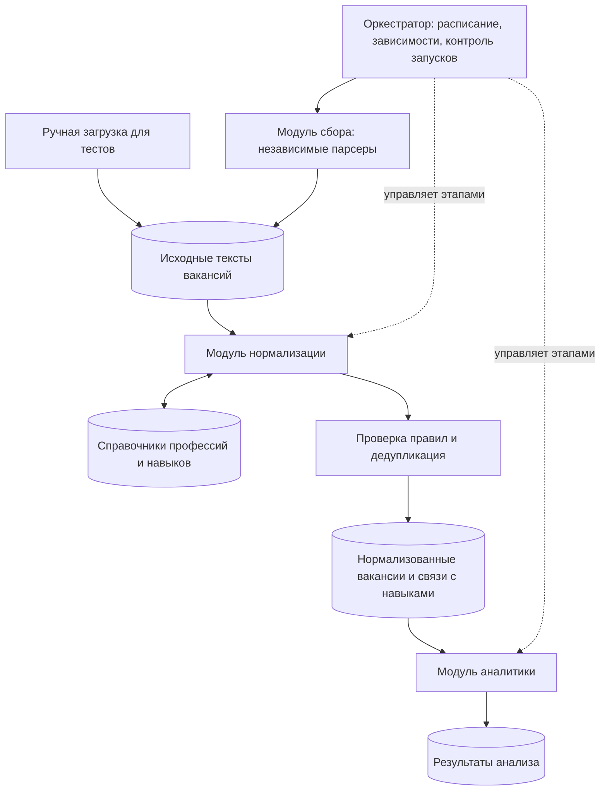

# Архитектура системы анализа рынка вакансий

## Идея

Автоматизировать текущий ручной процесс: сбор текстов вакансий → выделение и нормализация требований → формирование таблиц вакансий и навыков → аналитика. На этапе разработки тексты можно загружать вручную для тестирования; в рабочем режиме сбор происходит автоматически.

**Предлагаемый подход — модульный монолит:** один проект с независимыми по логике модулями и единым механизмом управления задачами. Это даёт разделение ответственности для трёх разработчиков без инфраструктурных издержек микросервисов.

## Схема

## Как работает цикл

1. **Оркестратор** по расписанию запускает сбор и контролирует завершение этапов. Парсеры работают параллельно; каждый отвечает за свой источник. Система сохраняет исходные тексты и метаданные без потери оригинала.
2. **Нормализатор** после завершения сбора извлекает из текстов основную профессию и навыки трёх типов: обязательные, желательные и используемые в работе. Сопоставляет их с едиными справочниками и присваивает существующие ID; для отсутствующих навыков предлагает новые записи с проверкой на смысловые дубли.
3. **Валидация** проверяет соблюдение правил разметки: не придумывать требования из контекста, не объединять разные компетенции, не дублировать вакансии и ID, учитывать альтернативы вида «A или B». Неоднозначные случаи фиксируются отдельно, чтобы не попадать в проверенный набор данных без решения.
4. **Аналитика** запускается на подготовленных данных и сохраняет результаты. Конкретные показатели и алгоритмы определяются ответственным за аналитический модуль; сейчас важно согласовать только формат его входных данных.

## Принципы реализации

- **Одна база, разные логические области:** исходные вакансии, справочники, нормализованные данные и результаты аналитики. Исходный текст сохраняется для повторной обработки и аудита.
- **Контракты модулей:** единые структуры данных, явные входы/выходы и ответственность за изменение своих сущностей. Модули не зависят от внутренней реализации друг друга.
- **Управление выполнением:** каждый цикл имеет идентификатор и статусы этапов; предусмотрены повторные попытки, контроль зависших задач и частичных ошибок. Анализ запускается только для согласованного, проверенного набора данных.
- **Повторяемость:** повторная обработка не создаёт дубли, а изменения правил или модели позволяют заново нормализовать сохранённые исходные тексты.
- **Одинаковый процесс для тестов и эксплуатации:** ручной ввод заменяет только парсеры, но не нормализацию или аналитику.

## Почему не микросервисы на старте

Задача — последовательный пакетный конвейер, а не набор постоянно взаимодействующих онлайн-сервисов. Отдельные микросервисы добавят сетевые API, развёртывание и сопровождение, но не улучшат саму нормализацию. При сохранении независимых контрактов и запуске этапов отдельными задачами нужные компоненты позже можно вынести в сервисы без пересмотра всей схемы.

**Открыто для согласования:** критерии завершения сбора при ошибках отдельных источников; процедура подтверждения новых/неоднозначных навыков; формат передачи данных в аналитику и критерии качества нормализации.
