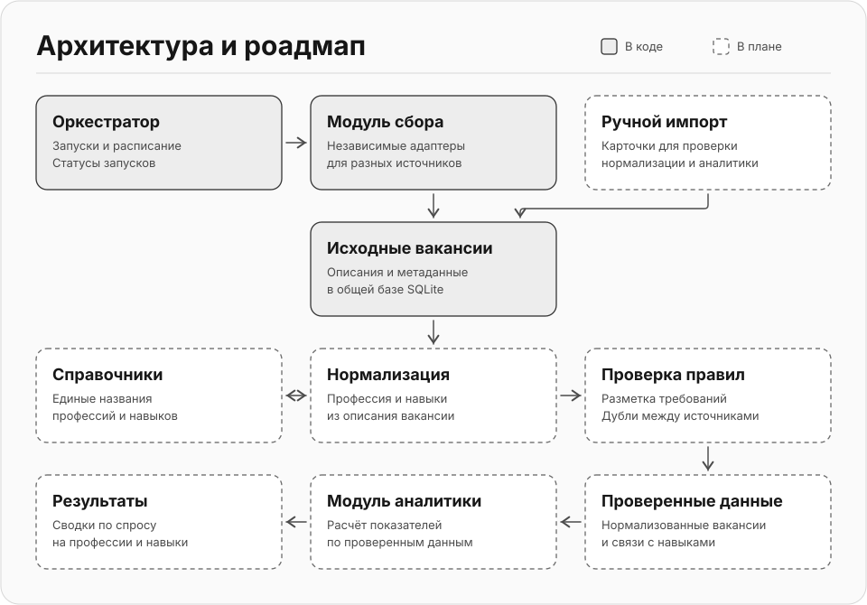

# Архитектура анализа рынка вакансий

Проект устроен как модульный монолит. Оркестратор запускает сбор и ведёт журнал. У каждого источника свой адаптер. Сборщики сохраняют карточки в одну базу, а ручной импорт будет подавать туда же примеры для проверки следующих этапов.

Нормализатор будет выделять профессию, обязательные и желательные навыки, а также навыки, которые применяют в работе. Профессии и навыки сверяются со справочниками. Затем отдельный шаг проверяет правила разметки, разбирает альтернативы вроде «PostgreSQL или MySQL» и объединяет смысловые дубли. Аналитика получает проверенные вакансии и их связи с навыками.

В репозитории уже есть общий сбор, хранилище и адаптер HH. В плане остались другие источники, ручной импорт, нормализация, проверка и аналитика.

## Как подключить источник

Адаптеры лежат в [`vacancy_analysis/sources/`](../vacancy_analysis/sources/). Адаптер отвечает за поиск и разбор карточек. Он задаёт уникальный `source`, возвращает ID из `vacancy_ids(query)` и отдаёт объект `Vacancy` из `vacancy(id)`. Оркестратор вызывает эти методы через протокол `Collector` и передаёт результат в хранилище.

В `Vacancy` входят внешний ID, URL, заголовок, исходное описание, дата публикации и словарь метаданных. Поля карточки имеют общую форму, а метаданные зависят от источника. У разных площадок могут совпадать внешние ID. Записи различаются по паре `(source, external_id)`. Смысловые дубли между площадками разбираются на этапе проверки.

Ошибки источника передаются через `CollectionError`. Для недоступной карточки, архива и блокировки доступа есть соответственно `VacancyUnavailable`, `VacancyArchived` и `AccessBlocked`. Успешно полученные карточки записываются по мере сбора и остаются в базе при сбое.

[Инструкция для адаптера HH](hh.md)

## Хранилище

| Таблица | Что хранит |
| --- | --- |
| `raw_vacancies` | Исходные карточки и метаданные по паре `(source, external_id)` |
| `runs` | Источник, запрос, период, статус и счётчики запуска |
| `run_vacancies` | Связь запуска с карточками, сохранёнными в нём |

В слое нормализации появятся справочники, проверенные вакансии и связи с навыками. Показатели аналитики формируются после проверки данных.
