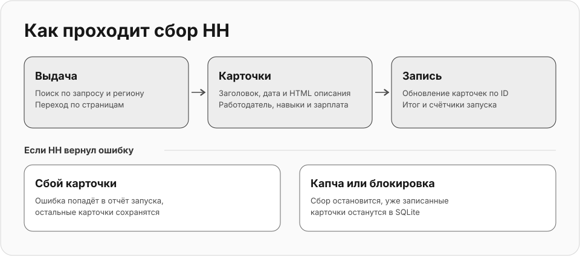

# Сбор вакансий HH



## Запуск

Скачайте файл для своей системы из [Releases](https://github.com/lentra0/vacancy-analysis/releases) и подставьте его версию в команды ниже. Неявный `watch` и `--output` доступны в исходниках после коммита `02a4bce`; для бинарника нужна сборка с этими изменениями. Chromium входит в сборку. На Linux нужны его системные библиотеки.

```powershell
$version = 'v0.1.10'
$app = ".\vacancy-analysis-windows-x64-${version}.exe"
& $app --text DevOps
& $app export > vacancies.json
```

```sh
version=v0.1.10
app="./vacancy-analysis-linux-x64-${version}"
chmod +x "$app"
"$app" --text DevOps
"$app" export > vacancies.json
```

Для запуска из исходников нужен Python 3.11 или новее. После установки используйте `python -m vacancy_analysis` с теми же параметрами.

```sh
python -m venv .venv
. .venv/bin/activate
python -m pip install -r requirements.txt
python -m playwright install --no-shell chromium
python -m vacancy_analysis --text DevOps
python -m vacancy_analysis export > vacancies.json
```

В PowerShell виртуальное окружение активируется командой `.\.venv\Scripts\Activate.ps1`. Если в Ubuntu не хватает библиотек Chromium, выполните `python -m playwright install --with-deps --no-shell chromium`.

## Параметры

По умолчанию запускается `watch`. Единственный обязательный параметр сбора — `--text` (непустая строка). Например:

```sh
python -m vacancy_analysis --text "DevOps"
```

Явная команда `watch` эквивалентна запуску без подкоманды. `run` выполняет один проход. `--db` задаётся перед подкомандой или перед параметрами неявного `watch`.

| Где | Параметр | Что задаёт |
| --- | --- | --- |
| Перед командой | `--db ПУТЬ` | Файл SQLite. По умолчанию `vacancy-analysis-data/vacancies.sqlite3` |
| `run`, `watch` | `--text ЗАПРОС` | Поисковый запрос. Обязательный |
| `run`, `watch` | `--area ID` | Регион HH. Например, `1` для Москвы |
| `run`, `watch` | `--limit N` | Сколько карточек можно открыть за запуск. По умолчанию 25 |
| `run`, `watch` | `--pages N` | Сколько страниц выдачи просмотреть. По умолчанию 3 |
| `run`, `watch` | `--period ДНИ` | Период выдачи HH. Допустимы 1, 3, 7 и 30. По умолчанию 1 |
| `run`, `watch` | `--delay СЕКУНДЫ` | Пауза между открытиями страниц. По умолчанию 10 |
| `run`, `watch` | `--profile КАТАЛОГ` | Профиль Chromium. По умолчанию подхватывается `vacancy-analysis-data/hh-profile` |
| `run`, `watch` | `--headed` | Показать Chromium и дать пройти проверку HH вручную |
| `watch` | `--interval СЕКУНДЫ` | Положительное целое число, по умолчанию 300. Первый сбор начинается сразу |
| `watch` | `--output ПУТЬ` | Путь к JSONL, по умолчанию `data/vacancies.jsonl` |
| Все команды | `--help`, `-h` | Справка по CLI |
| `login` | `--profile КАТАЛОГ` | Профиль для ручного входа в HH. По умолчанию `vacancy-analysis-data/hh-profile` |
| `runs` | `--limit N` | Сколько последних запусков показать. По умолчанию 10 |
| `export` | `--limit N` | Сколько свежих карточек выгрузить. По умолчанию все |

Все числовые параметры `--limit`, `--pages`, `--delay`, `--interval` принимают целые числа больше нуля. `--area` принимает строковый ID региона; без него регион не ограничивается. `--db`, `--profile`, `--output` принимают пути. `--headed` — флаг без значения; по умолчанию выключен. Лимит карточек применяется к каждому циклу, а не ко всему времени работы.

## Регулярный сбор

`watch` берёт свежую выдачу и пропускает вакансии, которые уже сохранены для того же запроса и региона. `run` перечитывает карточки и обновляет их в базе. Дубли в выдаче определяются по ID. В терминале обновляется строка с текущей страницей, карточкой или паузой и временем на этом шаге. В режиме `watch` JSONL обновляется после каждой сохранённой карточки атомарной заменой файла. Каждая строка содержит отдельный JSON-объект; выгрузка включает все карточки из выбранной базы. В терминале отображаются текущий этап, число сохранённых карточек, название последней карточки и обратный отсчёт между циклами. `run` сохраняет прежний JSON-отчёт в stdout. При неуспешных циклах интервал увеличивается экспоненциально до 32 базовых интервалов и сбрасывается после успешного цикла. При блокировке сбор прекращается. Для штатной остановки нажмите Ctrl+C.

Для входа в аккаунт запустите `login`, войдите в HH и нажмите Enter в терминале. При запуске из той же папки команды `run` и `watch` подхватят профиль. Для своего каталога передайте одинаковый `--profile` при входе и сборе.

База и профиль из прежнего каталога `data` подхватываются автоматически, пока в `vacancy-analysis-data` нет одноимённой базы или профиля.

Если HH покажет капчу, запустите сбор с `--headed`. Пройдите проверку в окне Chromium и нажмите Enter в терминале. Сбор проверит страницу один раз и продолжится, если она открылась.

```sh
python -m vacancy_analysis login
python -m vacancy_analysis run --text DevOps --area 1 --headed
python -m vacancy_analysis watch --text DevOps --area 1 --interval 7200
python -m vacancy_analysis runs --limit 3
```

`run` возвращает код `0` при успехе, `2` при частичном результате и `1` при ошибке. `export` печатает массив карточек с полями `external_id`, `title`, `description_raw`, `published_at` и `metadata`, а также ссылкой, источником и временем сбора.

## Тесты и сборка

```sh
python -m unittest discover -s tests -v
python -m unittest discover -s tests -p test_hh_web.py -v
```

Тест веб-сборщика читает две страницы выдачи и карточки из `tests/fixtures`, затем проверяет результат команды `export`. Другие тесты проверяют дубли, остановку при капче, частичные сбои и работу SQLite. Для прогона через Chromium установите его и задайте `HH_TEST_CHROMIUM=1`. Chromium открывает страницы из тестов. CI также поднимает локальный HTTP-сервер и проверяет сбор и выгрузку через готовый бинарник.

Сборку выполняйте на целевой системе x64. Результат появится в `dist/`.

```sh
python -m pip install -r requirements-build.txt
python scripts/build.py
```

[Общая архитектура и таблицы базы](architecture_vacancy_analysis.md)
